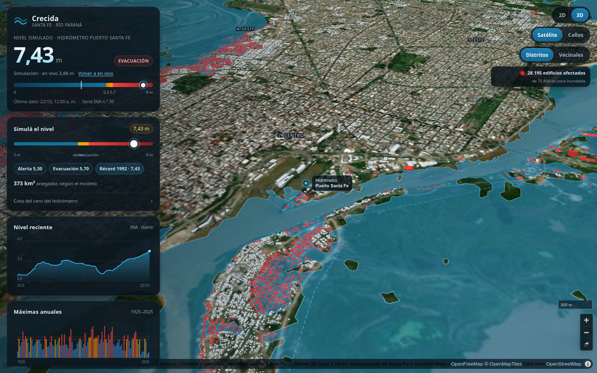

# Crecida · Santa Fe

**Nivel del río Paraná en vivo, simulación de crecidas y edificios 3D.**

Aplicación web estática para Santa Fe: consulta el hidrómetro Puerto Santa Fe y el río Salado (estación Recreo), permite simular una crecida entre 3 y 8 metros y muestra la hidrografía permanente, la mancha de inundación y los edificios afectados sobre un mapa 2D/3D.



> **Es una estimación geométrica, no un pronóstico oficial.** El modelo no simula velocidad, caudal, duración, lluvia, defensas ni obras hidráulicas.

## Qué permite

- Ver el **nivel del río en vivo** desde la serie 30 del INA.
- Ver el **río Salado** (estación Recreo, serie 103): nivel, estado, serie y máximas anuales.
- Simular niveles con un slider y botones rápidos: alerta, evacuación y récord.
- Visualizar la **hidrografía permanente** del Paraná, la Laguna Setúbal y el Río Coronda.
- Activar **terraplenes** y **zona de seguridad hídrica**; los terraplenes además actúan como barrera dentro del modelo.
- Visualizar el **polígono de inundación** calculado sobre un DEM.
- Ver **distritos y vecinales** municipales.
- Explorar la ciudad en **3D** con terreno, satélite y edificios extruidos.
- Pintar en rojo los edificios cuya cota queda bajo el agua simulada.
- Consultar la serie reciente y las máximas anuales desde 1925.
- Ajustar la cota del cero del hidrómetro para calibrar el DEM.

## Estado de los datos

| Dato | Valor |
|---|---:|
| Edificios en 3D | 75.808 |
| Edificios afectados en el récord de 1992 (7,43 m) | 28.195 |
| Edificios afectados al máximo de 8,00 m | 38.926 |
| Tiles vectoriales | 469 (7,9 MB) |
| Hidrografía permanente | 810 features (1,2 MB) |
| Río Salado · Recreo | serie 103, alerta 4,70 m |
| Máximas anuales del Salado | 2001–2026 (récord 7,89 m) |
| Terraplenes | 12 alineamientos, 313 cotas (12,3–24,4 m) |
| Resolución del DEM | ~32,5 m |
| Serie histórica | 1925–2026 |

El dataset 3D incluye edificios con cota de terreno ≤ 18 m. Se excluyen las zonas altas que no pueden inundarse con el máximo del simulador, para reducir el peso y mejorar el rendimiento. No se excluye ningún edificio que pueda afectarse dentro del rango de simulación.

## Stack

- React 19 + Vite 7
- MapLibre GL JS 5
- `d3-contour` para los contornos de agua
- DuckDB Spatial para generar los tiles (offline)
- Datos estáticos: PBF, binario de cotas y JSON histórico

No hay backend ni claves de API.

## Empezar

Requiere Node.js 20.19+ o 22.12+.

```bash
git clone https://github.com/JulyAnAr88/crecida-santafe.git
cd crecida-santafe
npm install
npm run dev
```

Abrir:

```text
http://localhost:5173/
http://localhost:5173/?vista=3d
```

Para bajar el servidor: `Ctrl+C`. Si quedó en segundo plano: `fuser -k 5173/tcp`.

### Build de producción

```bash
npm run build
npm run preview
```

El build queda en `dist/`. La app usa `base: './'`, así que puede publicarse en la raíz o en un subdirectorio siempre que se copien también:

```text
dist/data/edificios-cotas.bin
dist/data/agua-permanente.geojson
dist/tiles/
```

## Cómo funciona

```text
INA ───────────────┐
WFS municipales ───┤
DEM terrarium ─────┼──> React ──> MapLibre
Hidrografía OSM ───┤
Terraplenes ───────┤
Tiles PBF ─────────┤
Cotas binarias ────┘
```

1. La app consulta el INA cada 10 minutos y toma el último valor como nivel en vivo.
2. El usuario puede simular un nivel entre 3,00 y 8,00 m.
3. La elevación del agua se calcula como `nivel INA + 8,378 m` (cero del hidrómetro).
4. El DEM se descarga en z13, se decima a ~32,5 m y se suaviza con mediana 3×3.
5. La hidrografía permanente de Overture/OSM se dibuja debajo de la inundación, incluso fuera del área del DEM.
6. Los terraplenes (313 cotas municipales) se rasterizan como barrera: cada celda toma la altura máxima entre DEM y cota; los tramos sin cota bloquean siempre.
7. Un BFS conectado al río marca las celdas con altura efectiva ≤ elevación del agua.
8. `d3-contour` genera el polígono y se simplifica con RDP.
9. Los edificios se pintan en rojo si `cota ≤ elevación del agua`.

Más detalle: [Documentación técnica completa](docs/DOCUMENTACION.md).

## Edificios y alturas

Los edificios combinan dos fuentes:

- **Municipalidad de Santa Fe:** 21.455 edificios del este, con `altura_max` de 2,5 / 5 / 7,5 m.
- **Overture Maps:** 54.353 edificios del oeste con huellas reales. Se usa `height`; si no existe, `num_floors × 3 m`; si tampoco, 3 m estimados.

La cota de cada edificio se calcula con 9 muestras del DEM alrededor de la huella y una regla de robustez para descartar valores anómalos. Se guarda en los tiles y en un binario ordenado que permite contar afectados por búsqueda binaria.

## Estructura

```text
fuentes/terraplenes/        # shapefile original (no se publica)
scripts/                    # regeneración de terraplenes e historia del Salado
src/
├── App.jsx                 # estado, simulación, gráficos
├── components/Mapa.jsx     # MapLibre, capas, edificios, popups
├── components/*Chart.jsx   # series y máximas anuales
├── config/santaFe.js       # bbox, umbrales, semillas, estación Recreo
├── data/                   # series históricas (Paraná y Salado)
└── lib/                    # DEM, flood, INA, zonas, terraplenes
public/
├── data/
│   ├── agua-permanente.geojson
│   ├── edificios-cotas.bin
│   └── terraplenes.geojson
└── tiles/13-15/*.pbf
docs/
├── DOCUMENTACION.md
└── captura.png
```

## Limitaciones

- Modelo geométrico: no es un estudio hidráulico ni un pronóstico oficial.
- DEM de ~30 m; puede incluir techos, árboles o terraplenes.
- Los terraplenes actúan como barrera con su cota levantada (levantamiento 2020), pero solo donde hay puntos: los huecos entre sectores y las zonas fuera de la bbox no frenan el agua.
- No modela bombas, compuertas, viento ni lluvia local.
- El nivel del río Salado es solo de monitoreo: no modula la simulación (otra cuenca y otro cero).
- La cota es del terreno alrededor de la huella, no de la planta baja.
- El rojo se asigna por cota, sin verificar conectividad con el polígono de agua.
- El filtro cota ≤ 18 m asume el cero oficial y el máximo de 8 m. Si se sube mucho la calibración del cero, hay que regenerar los datos.
- La hidrografía permanente es una referencia visual de Overture/OSM: no cambia con el nivel del río y puede estar desactualizada.
- El Río Coronda se ve en la capa permanente, pero no está incluido en el modelo de inundación porque queda fuera del DEM.
- Los tiles, la hidrografía y las cotas son una foto estática; no se actualizan solos.

## Fuentes y créditos

- **Nivel del río:** INA–SIyAH, serie 30; datos primarios de Prefectura Naval Argentina.
- **Río Salado:** INA–SIyAH, serie 103 (estación Recreo).
- **Terraplenes y zona de seguridad hídrica:** Municipalidad de Santa Fe.
- **Edificios, distritos y vecinales:** Municipalidad de Santa Fe.
- **Edificios del oeste e hidrografía permanente:** Overture Maps Foundation / OpenStreetMap contributors.
- **Relieve:** Mapzen Terrain Tiles / AWS Open Data.
- **Satélite:** Sentinel-2 cloudless © EOX.
- **Calles:** OpenFreeMap, © OpenMapTiles, © OpenStreetMap contributors.

Cada fuente conserva su licencia y requiere atribución al redistribuir la app o los datos derivados.
